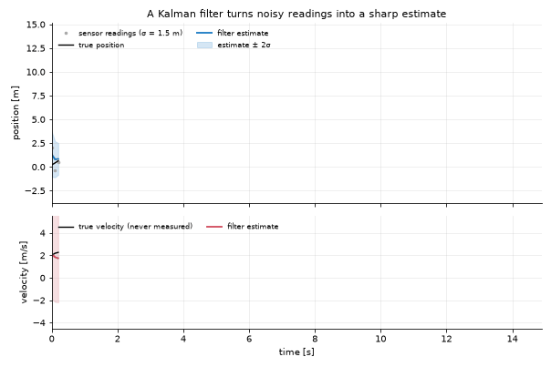

# Kalman World

State estimation for dynamical systems: Kalman filters, their nonlinear and
ensemble variants, and particle filters, written in C++ and used from C++ or
Python.



You describe a system once, as a **model**: how its state moves and what the
sensors see of it. A **filter** then turns noisy measurements into an
estimate of the state, with its uncertainty. The same model can be filtered,
smoothed, sampled, controlled, written to a file, or served over an API.

## What is inside

| Part | What it is |
|---|---|
| `libKalman` | the C++ core: models, filters, integrators, solvers, controllers. No required dependency |
| `libKalmanApps` | the application models in C++ |
| `libKalmanLearn` | learned components (ONNX, libTorch) |
| `libKalmanNet` | the JSON API, its REST and MCP servers (`kalman-serve`) |
| `kalman` (Python) | the interface: the same classes, models written in Python, the notebooks |
| `kalman` (program) | lists the models an installation can run and exports them to `.kw` files |

**Filters.** Gaussian beliefs: linear (KF), extended (EKF), unscented (UKF),
ensemble (EnKF), combinatorial track finding (CKF) and interacting multiple
models (IKF). Non-Gaussian beliefs: the particle filter. The filtering runs
in C++; a model written in Python is called back from the C++ loop.

**Applications.** Fifteen worked systems, from ballistics, rockets and space
navigation to particle tracking, gravitational waves, GPS, storms and
turbulent flow. Each has a page and a notebook: see
[Applications](docs/17_Applications.md).

## Quick start

```sh
make setup                       # Python dependencies, the C++ libraries (with cmake), a self-check
```

From Python:

```python
import numpy as np
from kalman.framework import KalmanModel

dt = 0.1
model = KalmanModel("tracker", fs=1 / dt,
                    F=np.array([[1, dt], [0, 1]]), H=np.array([[1.0, 0.0]]),
                    Q=np.diag([1e-4, 1e-3]), R=np.array([[0.1]]),
                    x0=np.zeros((2, 1)), P0=np.eye(2))

truth = model.sample(10.0, seed=1)     # a simulated run
estimate = model.filter(truth.zk)      # the filtered states, with their covariance
```

From C++:

```cpp
#include <Kalman/Kalman.h>

auto model = Kalman::Factory::Instance().Create("car-speed");
Kalman::Filter filter(model.get());
Kalman::IO::Record estimate = filter.Forward(measurements);
```

From the shell:

```sh
kalman models                    # every compiled model: dynamics, dimensions, noise
kalman model car-speed           # one model, component by component
kalman export car-speed -o car.kw
make serve                       # the REST API in the background, 127.0.0.1:8000
```

The same toy model, a cooling cup of coffee, is written in both languages in
[`examples/cxx/toy_plugin.cc`](examples/cxx/toy_plugin.cc) and
[`examples/python/toy_model.py`](examples/python/toy_model.py).

## Documentation

| | |
|---|---|
| [Getting Started](docs/1_Getting-Started.md) · [Installation](docs/2_Installation.md) · [Overview](docs/3_Overview.md) | first filter, setup, how it fits together |
| [Models](docs/4_Models.md) · [Filters and Diagnostics](docs/5_Filters-and-Diagnostics.md) · [Integrators and Solvers](docs/6_Integrators-and-Solvers.md) | describing a system and estimating it |
| [Providers](docs/7_Providers.md) · [Control and Routing](docs/8_Control-and-Routing.md) | data in, decisions out |
| [Python API](docs/9_Python-API.md) · [REST API](docs/10_REST-API.md) · [MCP Server](docs/11_MCP-Server.md) · [Authentication](docs/12_Authentication.md) · [Deployment](docs/13_Deployment.md) | access from other programs |
| [C++ Library](docs/15_Cxx-Library.md) · [C++ Models from Python](docs/16_Cxx-Models-from-Python.md) · [libKalmanNet](docs/18_Net.md) | the C++ side |
| [Applications](docs/17_Applications.md) · [Troubleshooting](docs/14_Troubleshooting.md) | worked systems, error messages decoded |

[`AGENTS.md`](AGENTS.md) holds the conventions for changing the code.

## License

LGPL-2.1-or-later. See [LICENSE](LICENSE).
