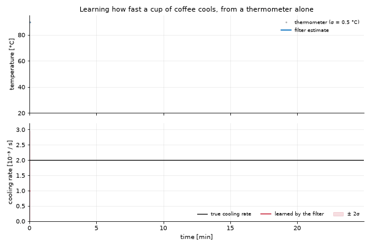

# C++ models from Python

This page is for someone who wants their filter to run fast and wants to know
what to write, and where. It answers three questions:

1. What runs in C++ today, and what runs in Python?
2. How do I write a model once in C++ and use it from both languages?
3. How do I check that the C++ path is really being used?

The worked example is a toy: a cup of coffee cooling in a room, read by a
thermometer. The same compiled model is run by a C++ program and by a Python
script, on the same sensor readings.

## What runs where

Python is the interface. You build models, run filters, read records and draw
plots in Python. The arithmetic underneath runs in C++ whenever the library is
installed, and in numpy when it is not. Nothing in your code changes between
the two.

| Piece | Where it runs | When |
|---|---|---|
| Filter workflow, records, plots, notebooks, the JSON API | Python | always |
| The Kalman update, the smoother, sigma-point and particle sums | C++ (`libKalman`) | when the library is found; numpy otherwise |
| A linear model with fixed matrices | C++, the whole pass in one call | when the library is found |
| A nonlinear model written in Python | the loop and the filter arithmetic in C++; C++ calls the Python `f` and `h` | extended, unscented, particle and ensemble engines, when the library is found |
| The integrators (Euler, RK4, Dormand-Prince): `step`, `integrate` | C++ (`Kalman::Integrators`), calling the Python derivative | real double-precision states; complex states and schemes written in Python stay in Python |
| The field solvers: `SpectralSolver.advance` (numpy backend) and `FiniteDifferenceSolver.advance` | C++ (`Kalman::Solvers::Vorticity`, `::FiniteDifference`) | a solver that states its physics (`NS2D`, `BetaPlaneNS2D`, diffusion); a subclass with other physics stays in Python |
| The ensemble filter of a field model (its own `forecast`, `observe`, `localization`, `initial_ensemble`) | the hooks stay the model's, in Python; the analysis arithmetic is the C++ kernel `enkf_analysis`, with numpy's draws | always, when the library is found |
| Sampling: `model.sample(...)` | the C++ loop; the noise is still drawn by numpy, so a seeded run is unchanged | extended engine |
| A closed loop: `forward(z, controller)` with a controller function | the same C++ loop, which calls the controller at every step | when the model takes a control |
| The controllers: P, PID, LQR, MPPI, Boost, AdaptiveQR | C++ (`Kalman::Controllers`); a Python model's `f`, `h`, noise and `clip_u` are called back | real double-precision models; the neural controllers stay in Python |
| The routers: Bayesian, Threshold, Hybrid | C++ (`Kalman::Routers`); a Hybrid's Python child is called back | when the library is found |
| A nonlinear model written in C++ | C++, the whole pass in one call | when its library is loaded |
| The four application models with a C++ twin | C++, the whole pass in one call | when `libKalmanApps` is found |

One loop runs every case, in C++. What differs is where the physics is
evaluated. A model written in Python is called back at every step, so its pass
costs about what the Python loop did (measured: 1.0 to 1.5 times faster with
the extended engine, 2.4 times with the unscented one in closed loop). A model
written in C++ never comes back to Python, and that is where the large factors
below come from.

**Noise and the `w`, `v` arguments.** `f(x, u, w, t)` and `h(x, v, t)` are the
contract's signatures, so every model has `w` and `v` whether it uses them or
not. The sigma-point and particle engines hand the noise to the map only when
the model declares no coupling (`L`, `M`) and the map really responds to the
argument (it is tried once, at the initial state). Otherwise the noise is
added, `L Q Lᵀ` and `M R Mᵀ`, as the extended engine does. A model that takes
`v` and ignores it therefore keeps its `R` in every engine.

## Controllers and routers

The classes keep their names, constructors and logs; what moved is the
arithmetic. Each one builds its C++ counterpart on first use and forwards
`_policy` and `_update` (a controller) or `route` (a router) to it. The Python
arithmetic stays as `_reference_policy`, `_reference_update`, `_reference_route`:
it is what runs inside `native.python_reference()`, for a complex model, and
without the library, and the tests compare the two
(`tests/test_native_controllers.py`, `tests/test_native_routers.py`).

| Class | C++ | What crosses | Agreement with the reference |
|---|---|---|---|
| `ProportionalKalmanController` | `Controllers::Proportional` | the belief, once per call | exact |
| `PIDKalmanController` | `Controllers::PID` (holds the integral) | the belief | 1e-17 |
| `LQRKalmanController` | `Controllers::LQR`, `Algebra::SolveDARE` | `model.F()`, `model.B()` once, at `fit()` | gain 1e-13 (scipy is the reference) |
| `MPPIKalmanController` | `Controllers::MPPI` (holds the warm start) | the perturbations, drawn in Python from the seeded generator; `model.f` and `clip_u` are called back per rollout step | 1e-11 |
| `BoostKalmanController` | `Controllers::Boost` | `H` and the current `R`, called back; the factor comes back and is applied to `model._R` here | the same boosts at the same steps |
| `AdaptiveQRKalmanController` | `Controllers::AdaptiveQR` | `H` and `R`, called back; the factor is applied to `model._Q` here | 1e-13 per call, 2.5e-11 after 280 closed-loop steps |
| `BayesianRouter` | `Routers::Bayesian` | `c` and the likelihoods (no NIS) | exact |
| `ThresholdRouter` | `Routers::Threshold` | the last `window` NIS rows | exact |
| `HybridRouter` | `Routers::Hybrid` | both children in C++, or a Python child (a `NeuralRouter`, a callable) called back | 1e-15 |

Three things follow from where the line is drawn:

- **The adapters retune the Python model.** Boost and AdaptiveQR decide in C++
  but apply the factor to `model._R` / `model._Q` in Python, and their C++ side
  reads `R` and `Q` from the Python model at every call. So the filter running
  the model sees the retuning, on the C++ loop as on the Python one, as before.
- **A seeded MPPI makes the same decisions** on both paths: the draws come from
  the controller's numpy generator in the order the reference draws them.
- **Changing a gain or a parameter rebuilds** the C++ object; for PID and MPPI
  that restarts the integral or the warm start. `reset()` resets both sides.

Two differences, both on innovations with a missing (NaN) channel: Boost scores
the channels present (the reference's NIS is NaN and never boosts) and
AdaptiveQR leaves the innovation out of its window (the reference's factor
becomes NaN). An empty NIS history gives a ThresholdRouter uniform
probabilities on both paths.

How long one call takes (`tools/benchmark_controllers.py`, best of five; the
Python column is the same class on its reference path, everything else as
shipped):

| Call | C++ | Python |
|---|---|---|
| Proportional, PID, LQR policy (one call with its logging) | 12 to 15 us | 6 to 9 us |
| LQR `fit()` (the Riccati equation) | 420 us | 210 us (scipy) |
| Boost, AdaptiveQR | 40 us | 37 to 40 us |
| MPPI 100 x 40 x 3 on the car (a Python `f`) | 219 ms | 201 ms |
| MPPI 100 x 40 x 3 on a C++ model (the example pendulum) | 18 ms | 70 ms |
| Bayesian, Threshold route | 4.5 to 6 us | 1.7 to 4.5 us |
| Hybrid(Bayes, Threshold) route | 13 us | 14 us |

So the C++ path is slower where the work is a few numpy operations: the
crossing (about 4 us) costs more than the arithmetic it replaces. It is level
where Python callbacks dominate (the adapters, MPPI on a Python model: the
model's `f` runs either way), and faster where nothing comes back to Python
(MPPI on a C++ model, 3.9 times). The Riccati solve is 2 times slower than
scipy's but more accurate (residual 1e-16 against 1e-14), and runs once.

## Install and check

```bash
make build                      # compiles libKalman and libKalmanApps
cmake --install var/build       # copies them to var/install/lib
python -c "import kalman.framework.native as n; print(n.HAS_C_ACCEL)"
```

`True` means Python found the library. It looks, in this order, at the file
named by `KALMAN_LIBRARY`, the `lib` folder under `KALMAN_ROOT`, this checkout (`var/install/lib`, then `var/build/lib`), and
finally the system loader.

`False` is not an error. Everything still works, on numpy.

## Three ways to write a model

| You want | Write | Speed of a nonlinear model |
|---|---|---|
| To try an idea quickly | a Python class (see [Models](4_Models.md)) | the C++ loop calling Python: about the speed of Python |
| One model for C++ programs, ROOT+ and Python | a C++ class, registered by name | the whole pass in C++ |
| An existing Python class to run faster, unchanged for its users | a C++ twin behind the Python class | the whole pass in C++ |

Measured on this repository's models (2000 steps, `tools/benchmark_twins.py`):
the C++ pass is 9 to 11 times faster for the storm and tornado models, 19 times
for the car, and 33 to 42 times for the ballistic model. The results agree with
the Python ones to about one part in a hundred million.

## The toy: one model, two languages

The same model is kept written twice, once in each language, as the worked
example of both ways to write one:

| File | What it is |
|---|---|
| `examples/cxx/toy_plugin.cc` | the model written in C++, built as `libKalmanPlugin_toy` |
| `examples/python/toy_model.py` | the same model written in Python, line for line |
| `examples/cxx/toy_sensor.cc` | a C++ program: simulates the sensor with the C++ model, filters, writes CSV |
| `examples/python/toy_sensor.py` | a Python script: both models on the same readings, compared |

`tests/test_examples.py` checks that the two state the same thing (one step,
the measurement, the noise, the initial state) and filter the readings alike.

Run it:

```bash
make build && make examples
./var/build/bin/toy_sensor                  # writes toy_sensor.csv and toy_estimate.csv
python examples/python/toy_sensor.py --plot # reads them, compares, saves toy_sensor.png
```



### The physics

Coffee cools toward the room temperature at a rate nobody measured. The filter
has to learn that rate from the thermometer alone, so the rate is part of the
state:

```
state        x = [T, k]      temperature [degC], cooling rate [1/s]
dynamics     T' = -k (T - T_room),   k' = 0
measurement  z = T           the thermometer
```

The product of `k` and `T` makes the model nonlinear, so it uses the extended
Kalman filter.

### The model, in C++

A model is a class with a step function `f` and a measurement function `h`:

```cpp
class CoolingCoffee : public Kalman::Models::Extended
{
    double fRoom = 21.;

public:
    CoolingCoffee() : Kalman::Models::Extended("toy-coffee", 2, 1)   // 2 states, 1 measurement
    {
        DeclareParameter("room", 21.);     // a setting others can change by name
        ParametersChanged();
        SetSampleRate(1.);                 // one reading a second
        // ... Q, R, the initial state and its covariance
    }

    Kalman::Vector f(const Kalman::Vector &x, const Kalman::Vector &, double) const override
    {
        Kalman::Vector out(2);
        out(0) = fRoom + (x(0) - fRoom) * std::exp(-x(1) * DeltaT());   // exact cooling over one step
        out(1) = x(1);                                                  // the rate does not change
        return out;
    }

    Kalman::Vector h(const Kalman::Vector &x, double) const override
    {
        Kalman::Vector z(1);
        z(0) = x(0);                       // the thermometer reads the temperature
        return z;
    }

protected:
    void ParametersChanged() override { fRoom = Parameter("room"); }
};

KALMAN_REGISTER_MODEL(CoolingCoffee, "toy-coffee");   // this line makes it findable by name
```

The last line is the whole integration. Any program that loads the library can
now create the model by the name `toy-coffee` without seeing the class.

### Using it from C++

```cpp
Kalman::Factory &factory = Kalman::Factory::Instance();
factory.LoadPlugin("libKalmanPlugin_toy");
std::unique_ptr<Kalman::Model> coffee = factory.Create("toy-coffee");
coffee->SetParameter("room", 21.);

Kalman::Sampler sensor(coffee.get(), 2026);       // the test sensor, with a fixed seed
sensor.Generate(1800, truth0);                    // 30 minutes of readings

Kalman::Filters::EKF ekf(coffee.get());
Kalman::Record estimate = ekf.Forward(sensor.Measurements());
```

### Using it from Python

```python
from kalman.framework.native import core
from kalman.framework.models.native import NativeModel

core.load_plugin(core.resolve_plugin("KalmanPlugin_toy"))
coffee = NativeModel("toy-coffee", "thermometer")
coffee.set_parameter("room", 21.0)
print(coffee.parameters())                # {'room': 21.0}

record = coffee.filter(readings)          # the whole pass in C++
coffee.plot(record)
```

`coffee` is an ordinary model here. `filter`, `smooth`, `plot`, the diagnostics
and the JSON API all work on it.

### The model, in Python

`examples/python/toy_model.py` is the same model as a Python class:

```python
class CoolingCoffeeModel(ExtendedKalmanModel):
    DIFFERENTIATOR = KalmanDifferentiatorKind.CENTRAL      # as the C++ class linearises

    def __init__(self, sensor_id="thermometer", room=21.0, fs=1.0, **kwargs):
        self.room = float(room)
        self.n, self.m, self.l = 2, 1, 0
        kwargs.setdefault("Q", np.diag([1e-4, 1e-12]))
        kwargs.setdefault("R", np.array([[0.5 ** 2]]))
        kwargs.setdefault("x0", np.array([[80.0], [1e-3]]))
        kwargs.setdefault("P0", np.diag([25.0, 1e-6]))
        super().__init__(sensor_id, fs=fs, L=np.eye(2), **kwargs)

    def f(self, x, u=None, w=None, t=None):
        T, k = np.asarray(x, dtype=float).reshape(-1)
        out = np.array([[self.room + (T - self.room) * np.exp(-k / self.fs)], [k]])
        return out if w is None else out + np.asarray(w, dtype=float).reshape(2, 1)

    def h(self, x, v=None, t=None):
        z = np.asarray(x, dtype=float).reshape(-1)[:1].reshape(1, 1)
        return z if v is None else z + np.asarray(v, dtype=float).reshape(1, 1)
```

Nothing is compiled. `CoolingCoffeeModel().filter(readings)` is run by the same
C++ filter, which calls back into `f` and `h` at each step.

### What you should see

```
sensor  : 1800 readings, thermometer error 0.486 degC (RMS)
filter  : temperature error 0.080 degC (RMS)
learned : k = 0.001964 +/- 0.000035 /s   (truth 0.001977)
agreement with the C++ program (largest difference, relative to the largest value):
    model in C++                      : T 0.0e+00   k 0.0e+00   (11.1 ms)
    model in Python, C++ filter       : T 1.3e-13   k 4.7e-12   (90.5 ms)
    model in Python, Python filter    : T 1.3e-13   k 4.7e-12   (82.5 ms)
```

Four things to read from it. The filter is six times more accurate than the
thermometer. It learned the cooling rate to within its own error bar, starting
from a guess that was wrong by a factor of two. The model written in C++ gives
the C++ program's numbers exactly, because it is the same compiled model. And
the model written in Python agrees to about one part in 1e11, at eight times
the cost: the price of a model nobody had to compile. (The times were taken on
a busy machine; the ratio is what to read.)

## Named parameters

A model declares its settings once, with `DeclareParameter(name, default)`, and
refreshes anything derived from them in `ParametersChanged()`. From then on
every caller sets them by name:

| From | Read | Set |
|---|---|---|
| C++ | `model.Parameter("room")` | `model.SetParameter("room", 21.)` |
| Python | `model.parameters()` | `model.set_parameter("room", 21.0)` |
| C | `kalman_model_parameter(...)` | `kalman_model_set_parameter(...)` |

An unknown name is an error that lists the names the model does declare.
Parameters are numbers. A model whose size depends on a setting (two or three
states per axis, say) registers one name per size instead, as the ballistic
model does with `ballistic` and `ballistic-order2`.

## Giving an existing Python model a C++ twin

When a Python class already has users, keep it and put the C++ class behind it.
The four application models that do this are listed in
[the C++ library page](15_Cxx-Library.md), with the rules a twin must follow.
In short:

```python
from kalman.framework.models.native import NativeTwin

class StormModel(NativeTwin, ExtendedKalmanModel):

    def native_name(self):                       # which C++ model stands in for this one
        if self.steering is not None:            # a Python callback has no C++ counterpart
            return None
        return "storm"

    def native_parameters(self):                 # the settings to hand over, by name
        return {"omega": self.omega, "beta_drift": self.beta_drift}
```

`model.filter(z)` then runs in C++ when it can and in Python when it cannot.
The user of `StormModel` sees no difference except the time it takes.

To compare the two paths, switch the twins off:

```python
import kalman.framework.models.native as native
native.USE_NATIVE_TWINS = False        # or KALMAN_NATIVE_TWINS=0 in the environment
```

## When something goes wrong

| Symptom | Cause | What to do |
|---|---|---|
| `HAS_C_ACCEL` is `False` | the library was not built or not found | `make build`, `cmake --install var/build`, or set `KALMAN_ROOT` |
| `plugin: ... does not exist` | the plugin was not built | `make examples`; plugins are looked up in `var/install/lib` and `var/build/lib`, or in `KALMAN_PLUGIN_PATH` |
| `loaded but registered no model` | the plugin was linked against another copy of the library | rebuild the plugin with the library it will run with |
| A crash right after changing `Kalman/Model.h` | a library or plugin still compiled against the old header | rebuild everything together: the library, `libKalmanApps`, every plugin, and ROOT+ |
| `import torch` fails with a symbol error | `DYLD_LIBRARY_PATH` points at another libtorch | `unset DYLD_LIBRARY_PATH` for this environment |
| A twin is not used | the configuration has no C++ counterpart | `model.native_handle()` returns `None`; see the table in [the C++ library page](15_Cxx-Library.md) |
