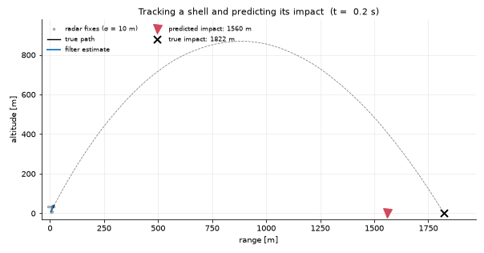

# Ballistics

A projectile under gravity and air drag, followed by a sensor that measures its
position. The filter recovers the velocity, which no sensor measures, and from
it the apex and the point of impact.



## The model

```
state        x = [p, v, a] on each of the three axes      (9 numbers; 6 without a)
dynamics     p' = v
             v' = gravity + drag,   drag = -(c_drag / m) |v| v
measurement  z = p                                         (the three positions)
```

Gravity is a constant `g` along z near the ground. With `g=None` it becomes the
pull of a central mass, `-G M p / |p|³`, for an orbit.

Two classes share this domain:

| Class | What it is | Filter |
|---|---|---|
| `BallisticLinearModel` | constant acceleration, no drag: the motion is linear | linear Kalman filter |
| `BallisticModel` | gravity and drag: the drag term is nonlinear in the velocity | extended Kalman filter |

## How it is built

- **Time stepping.** `BallisticModel` does not use an integrator from the
  framework. Its step is written out: `p += v dt + a dt²/2`, `v += a dt`, with the
  acceleration computed from the current state. That is exact for a constant
  acceleration and first order when drag changes it during the step. For a long
  step on an orbit, `substeps=N` cuts the step into N velocity-Verlet sub-steps,
  and `substeps="auto"` picks N from the orbital period.
- **Linearisation.** The extended filter needs the derivative of the step with
  respect to the state. It is taken numerically, by nudging each state
  component in turn.
- **Process noise.** `process_uncertainty` is `q` in m/s^1.5: left alone, the
  velocity wanders by `q √t`. It stands for what the model leaves out, such as
  wind.
- **C++.** `BallisticModel` has a twin in `libKalmanApps`
  (`Kalman::Apps::Ballistics::Ballistic`). With the default single step the whole
  filter runs there, about 30 to 40 times faster. Sub-stepping, a speed-dependent
  process noise and a thrust input keep the Python step.

## Using it

```python
from kalman.apps import BallisticModel

shell = BallisticModel("shell", fs=16, process_uncertainty=1.0, measurement_uncertainty=10.0)
shell.initial_state([0, 60, 0,   0, 0, 0,   0, 128, 0])    # p, v, a on x, then y, then z
fixes = shell.sample(28).zk                                # 28 s of simulated radar fixes
estimate = shell.filter(fixes)                             # estimate.xk, estimate.Pk
```

Notebook: [01_Ballistics](../../share/notebooks/01_Ballistics.ipynb).
