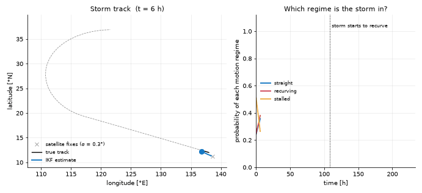

# Storm tracking

Two models for severe weather: the track and intensity of a tropical cyclone,
and the chance that the air is in a state that produces tornadoes.



## The storm model

A typhoon, a hurricane and a cyclone are the same phenomenon under regional
names, so there is one `StormModel`. The hemisphere is the only regional
setting.

```
state        x = [longitude, latitude, v_east, v_north, intensity]
dynamics     the velocity turns at the rate ω                 (ω = 0: straight)
             the centre moves with the velocity plus the beta drift
             the intensity persists
measurement  z = [longitude, latitude, intensity]             (a satellite fix)
```

The beta drift is the slow push toward the pole and the west that the Earth's
rotation gives every such storm. A storm that runs straight and one that
recurves differ only in the turn rate, so they are two **regimes** of one model.

## The tornado model

A tornado is too small and short-lived to track. What can be estimated is
whether the environment favours one. `TornadoEnvironmentModel` has a single
state that relaxes toward the level typical of its regime:

```
x' = μ + a (x - μ)          μ: the regime's level,  a: how long the air remembers
```

## How they are built

- **Time stepping.** Neither model uses an integrator. A turn at a constant
  rate has an exact solution over one step, and the model writes it out.
- **Regimes.** The filter does not know which regime the storm is in.
  `StormModel.ikf_bank()` returns one model per regime (straight, recurving,
  stalled) and the chance of switching between them. The Interactive Kalman
  Filter (IKF, the Interacting Multiple Model filter of the literature) runs
  them together and weighs each by how well it explains the fixes. For the
  tornado model the switching chances come from the season.
- **Forecast.** `forecast_cone` runs the model forward with no measurements.
  The growing covariance is the cone of uncertainty drawn on forecast maps.
- **Steering and intensity.** A steering wind and an intensity trend can be
  passed as Python functions. The storm then follows the wind and no longer
  needs a prescribed turn rate.
- **C++.** Both models have twins in `libKalmanApps`. A steering or intensity
  function keeps the Python step.

## Using it

```python
from kalman.apps import StormModel, synthetic_track
from kalman.framework.filters import InteractiveKalmanFilter

truth, fixes = synthetic_track(n_steps=40, recurve_at=18, fix_noise=0.3, seed=3)
models, transition, probabilities = StormModel.ikf_bank(fix_noise=0.3)
ikf = InteractiveKalmanFilter(models, transition, initial_probs=probabilities)
estimate = ikf.forward(fixes)
regimes = ikf.mode_probabilities            # one column per regime
```

Notebook: [14_StormTracking](../../share/notebooks/14_StormTracking.ipynb).
